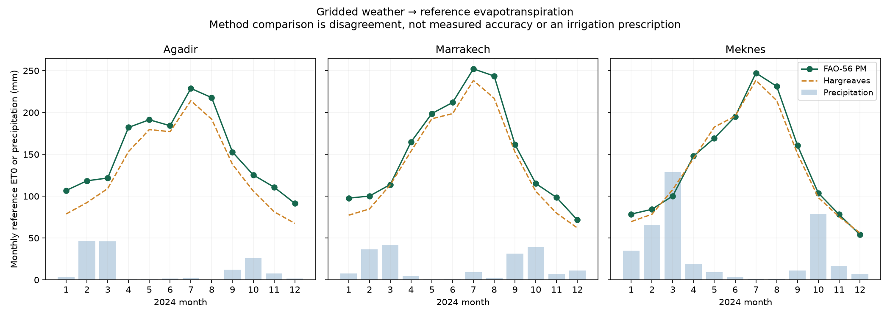

# Crop Water Demand — Reference ET0 & Explicit Scenarios

Daily FAO-56 Penman-Monteith reference evapotranspiration from public gridded weather, a Hargreaves comparison and hypothetical crop-coefficient scenarios.



## Scope and data

Estimate reference atmospheric water demand at three Moroccan NASA POWER points in **2024**, with **1,098 complete daily rows**. This physical-model project reuses the source archive of agroclimate-risk-analysis but answers a distinct question; it is not an additional independent source validation. The points represent coarse gridded products rather than local stations or irrigated fields. [NASA provenance, attribution, units and hashes](data/README.md), [manifest](data/source-manifest.json). Code MIT applies separately from source terms.

No measured crop evapotranspiration, phenology, effective rainfall, rooting depth, soil retention or actual irrigation is available. Outputs are reference ET0 and clearly assumed scenarios, not validated irrigation prescriptions, pump requirements or measured water savings.

## Physical method and assumptions

[FAO-56 chapters 3](https://www.fao.org/4/x0490e/x0490e07.htm) and [4](https://www.fao.org/4/x0490e/x0490e08.htm) define the reference calculation. Inputs use Tmax/Tmin in °C, wind already at 2 m in m/s, pressure in kPa, solar radiation in MJ/m²/day and day-of-year/latitude/elevation. Standard mean temperature is **(Tmax+Tmin)/2**, rather than NASA's hourly-derived T2M mean. Actual vapour pressure is approximated from RH2M and mean saturation pressure; daily RH mean is not the preferred RH extrema formula. This approximation adds uncertainty.

```text
es = [e(Tmax)+e(Tmin)]/2; ea ≈ RHmean/100 × es
gamma = 0.000665 × pressure; G = 0; albedo = 0.23
ET0 = [0.408×Delta×Rn + gamma×900/(Tmean+273)×u2×(es−ea)]
      / [Delta + gamma×(1+0.34×u2)]
```

Extraterrestrial radiation and daily longwave loss follow FAO geometry/temperature expressions. Rs/Rso is bounded to **[0.3,1]** as an explicit computational choice; FAO requires the upper bound, while the lower bound is a conservative cloud-factor assumption. Emissivity and final ET0 are bounded to nonnegative. The actual run bounds the cloud ratio on **82 days**, with no emissivity or negative-ET0 clipping. These choices are inspectable in the daily outputs and should be reviewed for regional calibration.

Hargreaves uses 0.0023×(Tmean+17.8)×sqrt(Tmax−Tmin)×Ra, with Ra converted from MJ/m²/day to equivalent **mm/day by multiplying 0.408**. The FAO daily Uccle example 18 reproduces approximately **3.88 mm/day**; the Lyon Hargreaves example 20 reproduces **5.0 mm/day**, within published rounding. These reference checks validate equation/units implementation, not Moroccan field accuracy.

## Executed results

| Grid point | Annual PM ET0 (mm) | Annual Hargreaves ET0 (mm) | Mean absolute method difference (mm/day) | Annual precipitation (mm) |
|---|---:|---:|---:|---:|
| Meknes | 1651.08 | 1613.02 | 0.421 | 377.04 |
| Marrakech | 1830.27 | 1676.30 | 0.553 | 192.22 |
| Agadir | 1832.16 | 1589.85 | 0.752 | 148.99 |

Method MAE/RMSE are **disagreement**, not accuracy against observed ground truth. Daily and monthly **P−ET0** is a climatic balance, not a root-zone water budget. Hypothetical constant Kc values **0.4, 0.8, 1.2** multiply ET0 throughout the year; they are not identified crops or observed growth stages. For Meknes these scenarios total 660.43, 1320.86 and 1981.29 mm. No effective-rainfall deduction or irrigation recommendation is inferred.

[Daily physical outputs and bounds](reports/daily-water-demand.csv), [monthly sums and scenarios](reports/monthly-water-demand.csv), [method comparison](reports/method-comparison.csv), [summary](reports/summary.json).

## Reproduce (Python 3.12)

```bash
python -m venv .venv
# Activate using your platform's command.
python -m pip install -r requirements-lock.txt
python -m pip install --no-deps -e .
python -m water_demand.analyze
python -m pytest -q
```

Source acquisition checks pinned scientific-content hashes, excluding only volatile response timings. Raw files are saved locally and ignored in Git. [Executed notebook](notebooks/01_evidence.ipynb), [verification](docs/verification.md), [learning guide](docs/learning-guide.md), [interview notes](docs/interview-notes.md), [design](docs/design.md). CI is pending scheduled publication.

The helper supports nonpolar latitudes up to 60° and checks documented physical ranges. It is an educational retrospective implementation with explicit bounds, not a general all-climate agronomic service. Validate against independent station and lysimeter/reference-ET observations before field use. Development assisted by AI; the author should understand equations and limitations personally.
