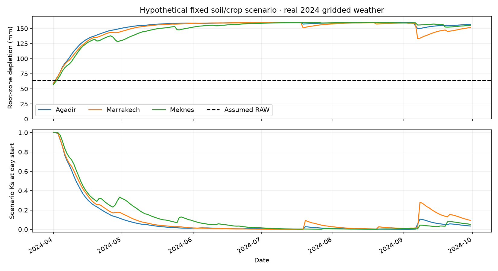

# Root-zone scenario extension — 6 October 2026

The climatic P−ET0 series remains unchanged. A separate fixed-root-zone calculation now tracks storage, depletion, adjusted ET and drainage. Units are explicit: volumetric retention, metres for rooting depth and millimetres for water fluxes. This closes a physical scenario budget, rather than estimating actual irrigation demand from missing soil/crop observations.

[FAO-56 chapter 8](https://www.fao.org/4/X0490E/x0490e0e.htm) is the independent equation/reference-case source. TAW = 1000(θFC−θWP)Zr; RAW = p×TAW. Ks equals one below RAW and declines towards zero at TAW. The daily ledger includes net infiltration, irrigation, capillary supply, adjusted ET and same-day drainage. Published examples 36 and 37 independently check storage and the ten-day stress trajectory; they do not calibrate Moroccan fields.

Implementation choices: fixed roots/p/Kc; a single-coefficient stress approximation; Ks evaluated at day start; water arriving that day enters the ledger; drainage removes surplus after that day's ET. Adjusted ET is capped by available water. No dual-coefficient evaporation, root growth, irrigation efficiency or salinity model is inferred. Invalid ranges/non-finite values/overflow are rejected, and conservation is checked.

**Synthetic dataset created for demonstration purposes.** Soil/crop/management assumptions are hypothetical; meteorological forcing is real NASA POWER gridded data. The scenario uses no irrigation/runoff/capillary supply, April–September 2024, fixed Kc 1.2 and TAW 160 mm. Its low Ks values are model responses under those assumptions, not measured water stress or validated recommendations.

## Actual scenario results

| Point | Days | Precipitation mm | Potential ETc mm | Adjusted scenario ET mm | Ending depletion mm |
|---|---:|---:|---:|---:|---:|
| Agadir | 183 | 17.87 | 1388.78 | 119.73 | 156.86 |
| Marrakech | 183 | 49.01 | 1479.79 | 145.61 | 151.60 |
| Meknes | 183 | 45.29 | 1381.87 | 145.52 | 155.23 |

All 549 daily ledgers close to absolute residual below 3×10⁻¹⁴ mm; no drainage occurs in this specific run. This is numerical conservation, not measured accuracy or water savings. Full precision and the forcing-file hash are in `reports/root-zone-scenarios.json`; daily fluxes are in the adjacent CSV. Original ET0 reports are retained.

Reproduce after the existing analysis: `python -m water_demand.analyze`, then `python -m water_demand.scenarios`. Run `python -m pytest -q` for independent published-case and physical edge-case checks. AI-assisted implementation; actual soil profiles, crop stages and measured irrigation/outcomes remain required for field decisions.
